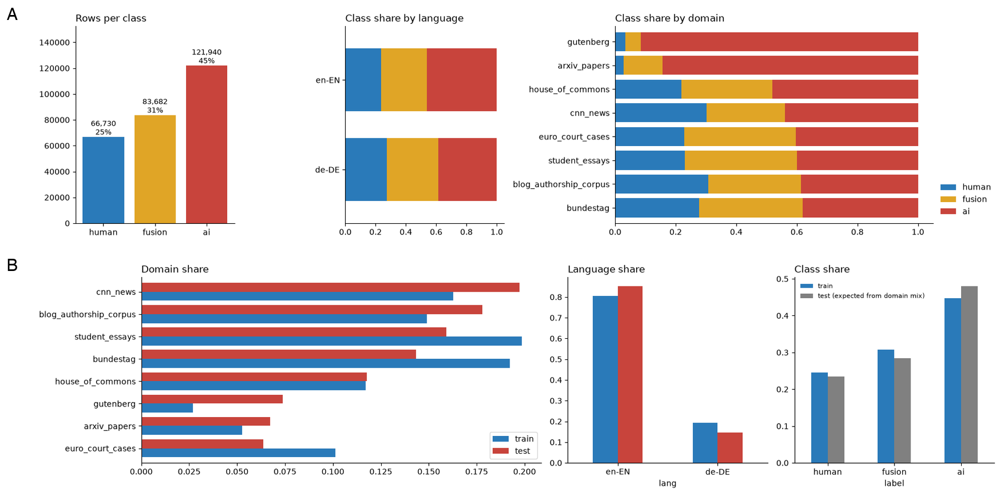
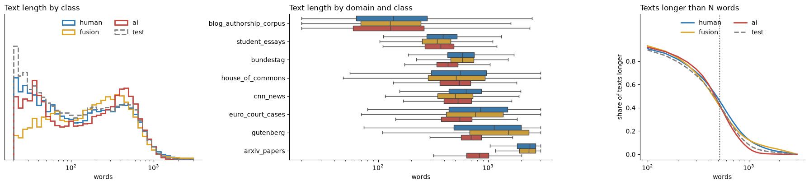
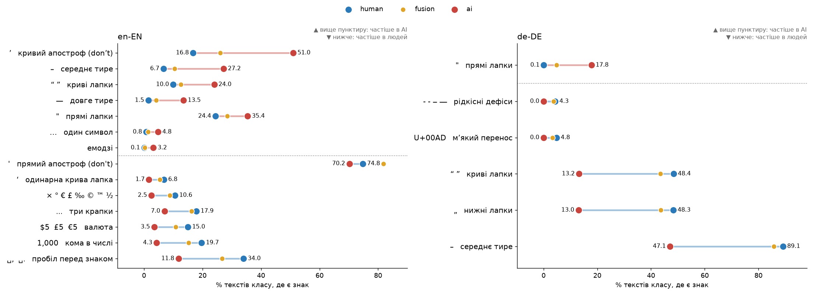
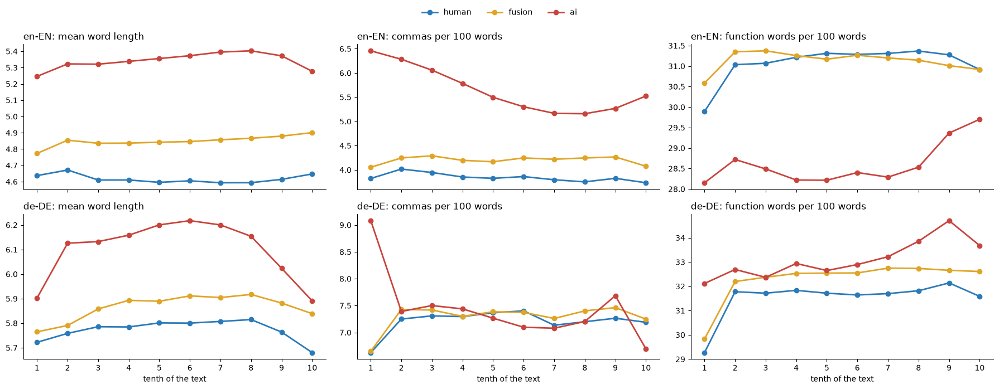
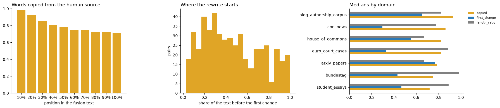
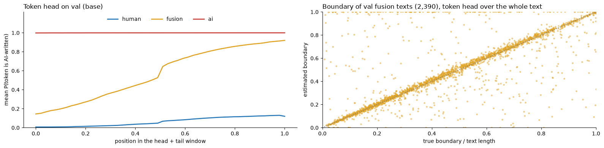
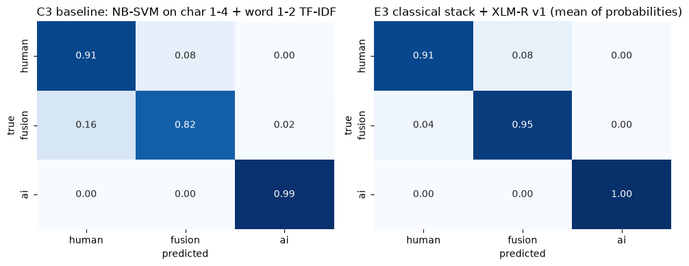
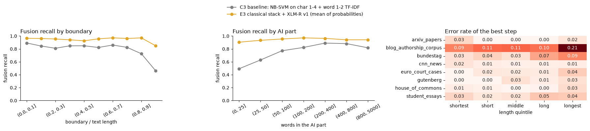
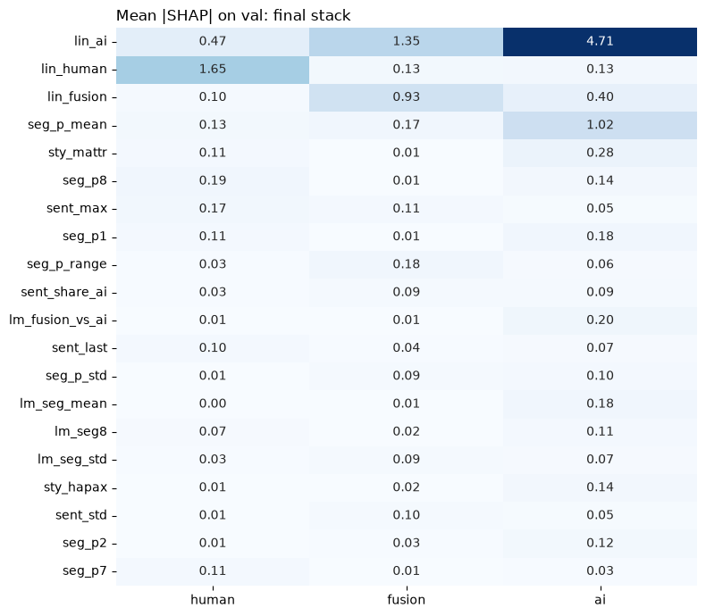
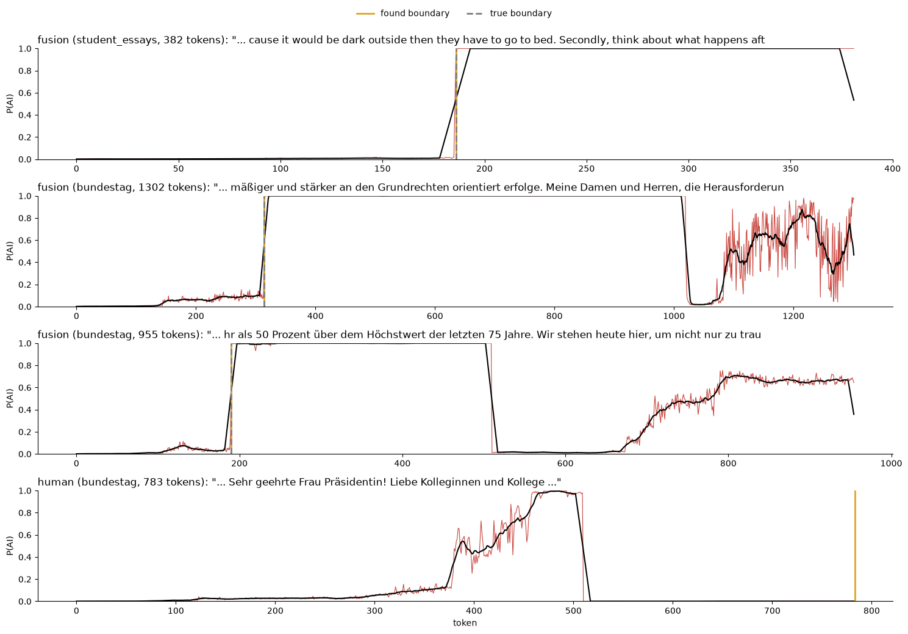

## Introduction

У цій роботі тексти англійською та німецькою мовами класифікуються за походженням: написані людиною (human), згенеровані ШІ (ai) або змішані (fusion). Метрика -- macro-F1.

Найкраща модель -- середнє ймовірностей класичного стека (LightGBM) і донавченого XLM-R: macro-F1 **0.9561** на валідації. На публічному лідерборді попередня версія цієї комбінації (сабміт 20.11, val 0.9544) отримала **0.95393**.

## Method

### EDA

*Рис. 1. A: класи загалом, за мовами та доменами (train); B: домени, мови та класи у train і test.*

У train 272 352 тексти: human 66 730, fusion 83 682, ai 121 940 (25 / 31 / 45 %, рис. 1A). У науковій та художній літературі переважає ШІ (arXiv ~0.84, Gutenberg ~0.92), а в політичних промовах, новинах і блогах частка ШІ менша за половину (Bundestag ~0.38, CNN ~0.44). Пропорції класів в обох мовах близькі (human / fusion / ai: EN ~0.24 / 0.30 / 0.46, DE ~0.28 / 0.34 / 0.38).

Німецьких текстів учетверо менше (52 771 проти 219 581), і майже всі вони з Бундестагу (52 343; решта 428 -- Gutenberg). Тому різницю між мовами важко відділити від різниці між доменами.

Набір доменів у train і test однаковий, але частки відрізняються (рис. 1B; train -> test: House of Commons ~0.12 -> 0.12, Bundestag ~0.19 -> 0.14, Gutenberg ~0.03 -> 0.07). Через це в Results наведено також macro-F1 із вагами доменів test.

*Рис. 2. Довжина тексту за класами та доменами.*

Довжина розрізняє класи лише в окремих доменах (рис. 2; медіани human проти ai у словах: arXiv ~2400 проти 830, Gutenberg ~1130 проти 700). У блогах і студентських есе медіани майже однакові.

*Рис. 3. Частка текстів зі знаком за класами, EN і DE, %.*

Класи відрізняються вживанням окремих знаків (рис. 3). В англійській ШІ частіше використовує кривий апостроф (human 16.8 -> ai 51.0 %), середнє тире (6.7 -> 27.2 %) та довге тире (1.5 -> 13.5 %), а люди частіше ставлять пробіл перед розділовим знаком (34.0 проти 11.8 %) і кому в числах (19.7 проти 4.3 %). У німецькій закономірність обернена: середнє тире є у 89.1 % людських текстів і лише у 47.1 % текстів ШІ. Значення fusion здебільшого лежать між human та ai, ближче до human.

В англійських текстах ШІ також частіше трапляється американський правопис (human 15.5 %, fusion 26.8 %, ai 45.0 %), а британський -- рідше (23.0 / 21.1 / 7.4 %).

*Рис. 4. Довжина слова, коми та службові слова на 100 слів уздовж тексту.*

В англійській люди вживають коротші слова та менше ком (рис. 4; довжина слова human ~4.6, ai ~5.3; ком на 100 слів human ~3.8, ai ~5.2-6.5). У німецькій слова ШІ теж довші, але кількість ком після першої десятої тексту майже не відрізняється. Частково це може пояснюватися походженням німецьких текстів -- майже всі вони є парламентськими промовами.

*Рис. 5. Слова fusion, скопійовані з human-джерела (до 500 пар), місце першої зміни та медіани за доменами.*

Fusion зазвичай починається як людський текст, а далі його продовжує ШІ. Для 78 % fusion-текстів (65 298) у train є human-текст із таким самим початком; медіанна межа -- 46 % довжини тексту. Частка слів, спільних із джерелом, спадає з ~0.99 у першій десятій до ~0.71 в останній (рис. 5). Друге значення завищене, бо збігом вважається навіть окреме спільне слово. Саме тому далі використано ознаки, які описують зміну стилю вздовж тексту.

### Validation

| показник | значення |
|---|---:|
| train / test, рядків | 272 352 / 25 000 |
| train для OOF-ознак (фолди 1-4) | 217 881 |
| валідаційна вибірка (із фолда 0) | 10 002 |
| фолди OOF, StratifiedGroupKFold | 5 |
| рядки зі спільним початком (100 символів): train / val / test | 45.1 % / 45.0 % / 0.7 % |
| "близнюк" в іншому фолді: випадковий KFold / за групами | 40.0 % / 0.0 % |

Human-текст і його fusion-версія мають однаковий початок. За випадкового поділу 40 % рядків мали б такого "близнюка" в іншому фолді, і оцінка була б завищеною. Тому поділ зроблено через StratifiedGroupKFold: група -- перші 100 символів, стратифікація -- за класом і доменом.

Ознаки для стека рахуються out-of-fold на 217 881 рядку, а всі моделі порівнюються на тих самих 10 002 валідаційних текстах. У test "близнюків" майже немає (0.7 %), тому окремо перевірено 55 % валідаційних рядків без "близнюка": найкраща модель має там macro-F1 0.9591, тобто результат не тримається на таких парах.

### Baseline

Baseline -- NB-SVM [1]: ознаки TF-IDF (символьні 1-4-грами, слова 1-2-грами) зважуються log-відношенням частот Naive Bayes, після чого навчається лінійний класифікатор (тут -- логістична регресія). До TF-IDF додано частоти артефактів: символи, пробіли, сліди джерела, формати чисел.

Параметри обирались на 15 000 рядках із 3 фолдами:

- **Нормалізація.** Уніфікація лапок, тире та веб-елементів погіршує результат, бо ці знаки розрізняють класи (рис. 3). Текст залишено без змін, а лічильники артефактів додають близько +0.006 до 0.8268.
- **Векторизація.** Випадковий пошук із LinearSVC дав найкращий CV macro-F1 0.8336.
- **Модель (CV macro-F1).** Найкращою є NB-SVM: ~0.85; далі LogReg ~0.845, SGD ~0.835, LinearSVC ~0.83 та ComplementNB ~0.62.

На валідації NB-SVM, навчений на 100 000 рядків, має macro-F1 **0.9055**. Найслабше місце -- fusion: recall 0.82, бо 16 % таких текстів прийнято за human. Клас ai відокремлюється майже ідеально (F1 0.9896).

### Encoder

**XLM-R v1** -- xlm-roberta-base [3] із класифікаційною головою: 512 токенів, 2 епохи, batch 16, lr 2e-5. Довгі тексти обрізаються до початку й кінця (head + tail), бо у fusion початок людський, а кінець переважно від ШІ.

Спосіб обрізання під час інференсу виявився вирішальним: head + tail, як у навчанні, дає 0.9345, середнє по вікнах (chunks) -- 0.8447, лише початок -- 0.8153. Коли модель бачить тільки початок, зміни авторства може не бути видно, і fusion плутається з human (F1 human 0.6563). Водночас head + tail відкидає середину тексту: приблизно для 29 % fusion межа потрапляє саме туди.

**XLM-R v2** має дві голови: класифікація тексту та P(ШІ) для кожного токена (вага втрати 0.5). Розмітка токенів береться з відомої межі fusion. Частка початку у вікні під час навчання випадкова (0.25-0.75), щоб модель бачила й середину тексту.

Результат -- 0.9380, тобто лише на 0.0035 вище за v1, хоча v2 навчався на меншій кількості текстів (174 302 проти 217 881). Головна користь v2 -- локалізація: для більшості fusion знайдена межа збігається з істинною (рис. 6).

*Рис. 6. XLM-R v2 на val: середня P(ШІ) токена за класами; знайдена та істинна межа для 2 390 текстів fusion.*

### My approach

Фінальна модель -- середнє ймовірностей (з рівними вагами) XLM-R v1 та класичного стека: LightGBM [4] над вісьмома групами ознак.

| група ознак | що обчислюється | налаштування |
|---|---|---|
| NB-SVM | 3 оцінки класів | TF-IDF char 1-4 + word 1-2 + артефакти, OOF |
| довжина, артефакти, домен | log довжини, символів на слово, мова, домен, частоти артефактів | на 1000 символів |
| zlib | 4: весь текст, дві половини, їхня різниця | рівень 9 |
| словники класів | 10: частка зекономлених байтів і різниці | 32 КБ, до 5 000 текстів, мова x клас |
| стилометрія + Delta | 14 + 5 | MATTR вікно 50; Delta: 150 слів |
| профіль сегментів | 14: P(ai) по сегментах, середнє, розкид, стрибок | 8 частин; char 1-4 + LogReg; навчено на human і ai |
| речення + точка зміни | 10: P(ai) речень, межа, контраст | char 2-4 + LogReg; до 400 000 речень |
| char LM | 18: log-відношення правдоподібностей, профіль 8 сегментів | 5-грами, згладжування 0.1, $2^{22}$ кошиків |
| стек | ймовірності класів | LightGBM: lr 0.03, 63 листки, рання зупинка |

Групи додавалися по одній; у дужках -- зміна macro-F1 на валідації. Стек лише на оцінках NB-SVM має 0.9126.

1. **Довжина, артефакти, домен** (0.9126 -> 0.9215). Залежність класу від довжини та знаків різна в різних доменах, і стек може це врахувати.
2. **zlib** (0.9215 -> 0.9213). Відношення розміру стисненого тексту до оригінального $C(x) / |x|$ -- швидка оцінка передбачуваності тексту без нейромереж. Приросту не дало.
3. **Стиснення зі словниками класів** (0.9213 -> 0.9208). Для кожної пари мова-клас будується словник із частих 2-3-грам слів; текст краще стискається словником класу, на який схожий лексикою. Приросту теж не дало, імовірно тому, що лексику вже описує TF-IDF.
4. **Стилометрія та Burrows' Delta** [2] (0.9208 -> 0.9239). В основі -- гіпотеза про "авторський інваріант": стійкі звички у вживанні службових слів, довжині речень і багатстві словника, що мало залежать від теми. Delta вимірює відстань від тексту до центроїда кожного класу за 150 найчастішими словами мови.
5. **Профіль по 8 сегментах** (0.9239 -> 0.9317). Класифікатор human / ai оцінює кожну восьму частину тексту. Середня P(ai) для ai ~0.95, для human ~0.09, а для fusion зростає від ~0.20 на початку до ~0.33 наприкінці. Один із двох найбільших приростів серед груп ознак.
6. **Класифікатор речень і точка зміни** (0.9317 -> 0.9357). За P(ai) кожного речення шукається межа, що найкраще ділить текст на людську частину та частину ШІ.
7. **Char 5-gram LM** (0.9357 -> 0.9366). Окрема мовна модель для кожного класу; приріст невеликий.
8. **Стек + XLM-R v1** (0.9366 -> 0.9561; F1 human 0.9004 -> 0.9283, fusion 0.9135 -> 0.9433, ai 0.9959 -> 0.9967). Стек описує знаки, правопис і стиль усього тексту, але майже не враховує зв'язків між словами. XLM-R враховує контекст, проте бачить лише 512 токенів. Моделі доповнюють одна одну, тому їхнє середнє краще за кожну окремо.

Не увійшли у фінальну модель: perplexity Qwen2.5-0.5B [6] (+0.0020 за ~91 хв GPU) та зсуви класів під macro-F1 (0.9366 -> 0.9366).

## Results

| # | Підхід | macro-F1 (val) | ваги доменів test | human | fusion | ai |
|--:|---|---:|---:|---:|---:|---:|
| 1 | **Стек + XLM-R v1, середнє ймовірностей** | **0.9561** | **0.9538** | 0.9283 | 0.9433 | 0.9967 |
| 2 | Стек + perplexity Qwen2.5-0.5B | 0.9386 | 0.9354 | 0.9035 | 0.9153 | 0.9969 |
| 3 | XLM-R v2, дві голови | 0.9380 | 0.9385 | 0.8974 | 0.9211 | 0.9954 |
| 4 | Класичний стек + зсуви класів | 0.9366 | 0.9329 | 0.9006 | 0.9135 | 0.9958 |
| 5 | Класичний стек (останній крок: char 5-gram LM) | 0.9366 | 0.9327 | 0.9004 | 0.9135 | 0.9959 |
| 6 | Стек: + класифікатор речень і точка зміни | 0.9357 | 0.9312 | 0.8999 | 0.9121 | 0.9951 |
| 7 | XLM-R v1, head + tail | 0.9345 | 0.9339 | 0.8932 | 0.9158 | 0.9947 |
| 8 | Стек: + профіль по 8 сегментах | 0.9317 | 0.9274 | 0.8948 | 0.9056 | 0.9948 |
| 9 | Класичний стек без NB-SVM | 0.9264 | 0.9215 | 0.8879 | 0.8966 | 0.9945 |
| 10 | Стек: + стилометрія, Burrows' Delta | 0.9239 | 0.9192 | 0.8833 | 0.8942 | 0.9943 |
| 11 | Стек: + довжина, артефакти, домен | 0.9215 | 0.9175 | 0.8807 | 0.8900 | 0.9939 |
| 12 | Стек: + zlib | 0.9213 | 0.9167 | 0.8804 | 0.8898 | 0.9935 |
| 13 | Стек: + стиснення зі словниками класів | 0.9208 | 0.9162 | 0.8797 | 0.8895 | 0.9933 |
| 14 | Стек: лише оцінки NB-SVM | 0.9126 | 0.9078 | 0.8679 | 0.8779 | 0.9920 |
| 15 | Baseline: NB-SVM | 0.9055 | 0.8993 | 0.8611 | 0.8658 | 0.9896 |
| 16 | XLM-R v1, chunks | 0.8447 | 0.8516 | 0.7125 | 0.8335 | 0.9881 |
| 17 | XLM-R v1, лише head | 0.8153 | 0.8209 | 0.6563 | 0.8033 | 0.9864 |

Найкращим є комбінований підхід: +0.051 до baseline (95 % інтервал paired bootstrap ~0.044-0.058). Він лишається першим і з вагами доменів test (0.9538). Рядки 2-5 відрізняються лише на 0.002, тому їхній порядок не варто вважати надійним.

| сабміт | macro-F1 (val) | public LB |
|---|---:|---:|
| stack-encoder (20.11) | 0.9544 | 0.95393 |
| stack (20.11) | 0.9329 | 0.93122 |
| classical-stack-xlmr (23.11) | 0.9561 | очікується |
| classical-stack (23.11) | 0.9366 | очікується |

Для сабмітів 20.11 валідація й лідерборд розходяться менш ніж на 0.002, отже, валідація добре відображає якість на test.

*Рис. 7. Матриці помилок на val: baseline і найкраща модель.*

Покращення припадає переважно на fusion: recall 0.82 -> 0.95, а частка fusion, прийнятих за human, зменшилася з 0.16 до 0.04. Зворотна помилка human -> fusion не змінилася (0.08) і тепер є найчастішою (рис. 7).

### Error analysis

*Рис. 8. Recall fusion за межею та довжиною AI-частини (baseline і найкраща модель); частка помилок найкращої моделі за доменом і довжиною.*

Baseline губить fusion, у яких частина ШІ коротка: recall ~0.49 для AI-частини до 25 слів і ~0.46, коли межа в останній десятій тексту. Найкраща модель має там ~0.90 і ~0.85 відповідно (рис. 8).

Найбільше помилок у blog_authorship_corpus (0.09-0.21 залежно від довжини). Це може бути пов'язано з природою корпусу: блоги здебільшого короткі, а письмові звички авторів дуже різні. Другий за кількістю помилок -- Bundestag на довгих текстах (0.07-0.09).

Серед найвпевненіших помилок (P = 0.99) -- два блоги: human на 118 слів, прийнятий за fusion, і fusion на 51 слово, прийнятий за ai. Третя -- промова з Бундестагу, де fusion прийнято за human.

### Explainability

*Рис. 9. Середнє |SHAP| стека LightGBM (3 000 рядків val), 20 найважливіших ознак.*

Стек найбільше спирається на оцінки NB-SVM (TreeSHAP [5], рис. 9): lin_ai -> ai 4.71, lin_human -> human 1.65, lin_ai -> fusion 1.35, lin_fusion -> fusion 0.93. Далі йде середня P(ai) по сегментах (seg_p_mean -> ai 1.02). Для fusion серед решти ознак помітні ті, що описують неоднорідність тексту: розмах P(ai) між сегментами (0.18) і розкид P(ai) речень (0.10). Водночас стек без NB-SVM має 0.9264, тобто інші групи значною мірою несуть ту саму інформацію.

*Рис. 10. P(ШІ) за токенами, XLM-R v2 (3 тексти fusion, 1 human), вікна по 510 токенів.*

У трьох прикладах fusion знайдена межа збігається з істинною: P(ШІ) різко зростає від ~0 до ~1 (рис. 10). У довгих текстах видно обмеження методу: на межі вікон P(ШІ) падає, хоча текст далі написаний ШІ, а в людській промові зростає до ~1 наприкінці першого вікна. Кожне вікно обробляється окремо, без попереднього контексту, і модель, імовірно, очікує людський початок і ШІ наприкінці. Для людського тексту точка зміни все ж потрапила в самий кінець, тобто частини ШІ не знайдено.

## Conclusion

Класичні ознаки дають 0.9366, один XLM-R -- 0.9345, а їхнє середнє -- 0.9561. Клас ai розпізнається майже без помилок, складною лишається межа між human і fusion. Найкорисніші ознаки описують зміну стилю вздовж тексту, а стиснення (zlib, словники) приросту не дало. Для XLM-R важливо, щоб спосіб обрізання тексту збігався в навчанні та інференсі.

Обмеження:

- Найкращу модель обрано на тій самій валідації, на якій її оцінено, тому 0.9561 може бути дещо завищеним.
- Модель передбачає в test ~0.24 fusion, тоді як за складом доменів очікується ~0.28; частину fusion вона, можливо, пропускає.
- XLM-R v2 не додано до комбінації. Від XLM-R v2 large і стека другого рівня довелося відмовитися через час: навіть v2 base виконувався 283.6 хв.
- 